# 渠道商与 Affiliate 分销模块设计文档

## 目录
- [1. 产品概述](#1-产品概述)
- [2. 核心概念与业务关系](#2-核心概念与业务关系)
- [3. 系统架构](#3-系统架构)
- [4. 数据模型设计](#4-数据模型设计)
- [5. 分成规则设计](#5-分成分规则设计)
- [6. 分成计算逻辑](#6-分成计算逻辑)
- [7. 业务流程设计](#7-业务流程设计)
- [8. API 接口设计](#8-api-接口设计)
- [9. 状态流转设计](#9-状态流转设计)
- [10. 关键约束与边界条件](#10-关键约束与边界条件)

---

## 1. 产品概述

在现有 AIPanelAdmin 系统中新增「渠道商 + Affiliate 分销模块」，采用插件化架构（`base/plugins/channel`），与 CRM 线索模块深度联动。通过渠道商/affiliate 归因线索，并在线索转化为商机/订单成交后，按规则自动计算各方分成。

### 核心能力
- **渠道商管理**：最多支持 2 层级（一级、二级渠道商），二级渠道商自动归属一级渠道商
- **Affiliate 管理**：个人推广员，独立于渠道商体系，通过推广码归因
- **线索归因**：CRM 线索创建时关联渠道商 / affiliate / 销售负责人，全链路可追溯
- **分成计算**：成交后自动计算「渠道商分成 + 上级渠道商分成 + 销售分成 + affiliate 分成」四类
- **结算管理**：按周期聚合分成记录，支持审核 → 打款流程

### 技术栈
- 后端：FastAPI + Tortoise ORM（与项目现有栈一致）
- 前端：Vue 3 + Element Plus
- 数据库：PostgreSQL
- 事件驱动：复用 `base.common.events.event_bus`，监听 `crm.lead.created` / `crm.lead.converted` / `crm.opportunity.won`

---

## 2. 核心概念与业务关系

### 2.1 概念定义

| 概念 | 定义 | 层级限制 |
|------|------|----------|
| 渠道商（Channel Partner） | 公司型合作方，可发展下级渠道 | 最多 2 级（一级、二级） |
| 二级渠道商 | 归属某一级渠道商的下级渠道 | 必须有 parent_id，且 parent 必须是一级 |
| Affiliate | 个人推广员，独立体系，无层级 | 单层，不发展下级 |
| 销售负责人 | 内部销售人员（系统用户），跟进并促成成交 | 由 Lead.assigned_to 承载 |
| 线索归因 | 线索来源渠道商/affiliate 的归属关系 | 一条线索最多归属 1 个渠道商 + 1 个 affiliate |

### 2.2 与 CRM 现有模块关系

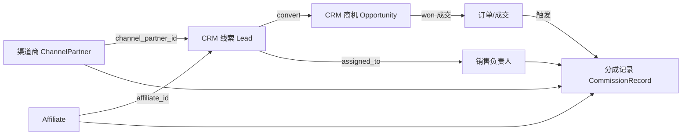

### 2.2.1 CRM 线索字段扩展

现有 `crm_lead` 表新增 3 个归因字段（不破坏现有 `source` / `assigned_to` 逻辑，二者继续保留）：

| 新增字段 | 类型 | 说明 |
|----------|------|------|
| channel_partner_id | BigInt, null | 归属渠道商 ID（一/二级均可） |
| affiliate_id | BigInt, null | 归属 affiliate ID |
| referral_code | Char(50), null | 推广码（affiliate 或渠道商通用码） |

> 约束：`channel_partner_id` 与 `affiliate_id` 可同时为空（自然线索），但不可同时指向"非空且无关联关系"。

---

## 3. 系统架构

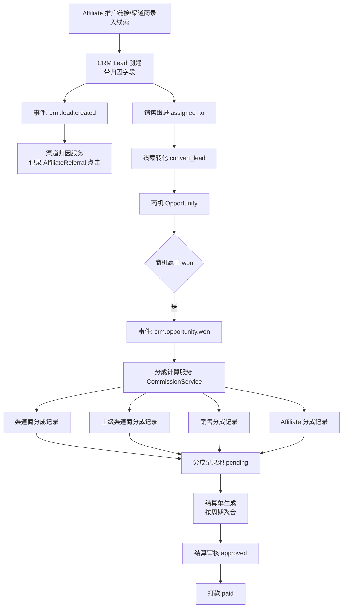

---

## 4. 数据模型设计

模型统一放在 `base/plugins/channel/models/`，继承项目的 `BaseModel` 与 `TimestampMixin`。

### 4.1 ChannelPartner（渠道商）

支持 2 层级：通过 `parent_id` + `level` + `parent_path` 表达。

| 字段名 | 类型 | 必填 | 说明 |
|--------|------|------|------|
| id | BigInt | 是 | 主键 |
| name | String(200) | 是 | 渠道商名称（公司名） |
| code | String(50) | 是 | 渠道编码（唯一） |
| level | Int | 是 | 层级：1=一级, 2=二级 |
| parent_id | BigInt | 否 | 上级渠道商 ID；二级必填，一级为 null |
| parent_path | String(500) | 否 | 物化路径，如 `1/5/`，便于查询子树 |
| partner_type | Enum | 是 | `company` / `individual` |
| contact_name | String(100) | 否 | 联系人 |
| contact_phone | String(20) | 否 | 联系电话 |
| contact_email | String(100) | 否 | 联系邮箱 |
| status | Enum | 是 | `pending` / `active` / `suspended` / `terminated` |
| commission_rate | Decimal(5,4) | 否 | 默认分成比例（0~1，如 0.15）；优先级低于规则 |
| parent_override_rate | Decimal(5,4) | 否 | 上级分成比例（仅一级渠道商配置，二级成交时上级按此拿） |
| bank_info | JSON | 否 | 收款信息 |
| remark | Text | 否 | 备注 |
| created_at / updated_at | DateTime | 是 | 时间戳 |

#### 约束
- `level=2` 时 `parent_id` 不能为空，且 parent 的 `level` 必须为 1
- `level=1` 时 `parent_id` 必须为 null
- 一级渠道商不可再被设为某渠道商的子级（防 3 层）
- `parent_path` 在创建/更新时自动维护：`/{parent_path}{self_id}/`

#### Tortoise 模型示例
```python
class ChannelPartnerLevel(int, Enum):
    FIRST = 1
    SECOND = 2

class ChannelPartnerStatus(str, Enum):
    PENDING = "pending"
    ACTIVE = "active"
    SUSPENDED = "suspended"
    TERMINATED = "terminated"

class ChannelPartner(BaseModel, TimestampMixin):
    name = fields.CharField(max_length=200, description="渠道商名称")
    code = fields.CharField(max_length=50, unique=True, description="渠道编码")
    level = fields.IntEnumField(ChannelPartnerLevel, description="层级 1/2")
    parent_id = fields.BigIntField(null=True, description="上级渠道商ID")
    parent_path = fields.CharField(max_length=500, null=True, description="层级路径")
    partner_type = fields.CharField(max_length=20, default="company", description="渠道商类型")
    contact_name = fields.CharField(max_length=100, null=True, description="联系人")
    contact_phone = fields.CharField(max_length=20, null=True, description="联系电话")
    contact_email = fields.CharField(max_length=100, null=True, description="联系邮箱")
    status = fields.CharEnumField(ChannelPartnerStatus, max_length=20,
                                  default=ChannelPartnerStatus.PENDING, description="状态")
    commission_rate = fields.DecimalField(max_digits=5, decimal_places=4, null=True,
                                          description="默认分成比例 0~1")
    parent_override_rate = fields.DecimalField(max_digits=5, decimal_places=4, null=True,
                                               description="上级分成比例(仅一级配置)")
    bank_info = fields.JSONField(null=True, description="收款信息")
    remark = fields.TextField(null=True, description="备注")

    class Meta:
        table = "channel_partner"
        table_description = "渠道商表"
        indexes = (("parent_id",), ("level",), ("status",))
```

---

### 4.2 Affiliate（推广员）

> **绑定策略**：affiliate 与 customer 是"可选绑定"，通过 `bind_mode` 区分两种业务形态：
> - `standalone`（默认）：纯第三方推广员，不绑 customer（KOL/代投/媒介公司）
> - `customer_referral`：老客户转介绍，必填 `customer_id`，被介绍人成为新 customer
>
> 这样既支持 B2B 渠道拓展，又支持电商/ SaaS 邀请奖励场景。

| 字段名 | 类型 | 必填 | 说明 |
|--------|------|------|------|
| id | BigInt | 是 | 主键 |
| user_id | BigInt | 否 | 关联系统用户 ID（若 affiliate 同时是注册用户） |
| customer_id | BigInt | 否 | 关联客户 ID（bind_mode=customer_referral 时必填） |
| bind_mode | Enum | 是 | `standalone` / `customer_referral`（默认 standalone） |
| name | String(100) | 是 | 推广员姓名/昵称 |
| code | String(50) | 是 | affiliate 编码（唯一） |
| referral_code | String(50) | 是 | 推广码（唯一，用于链接归因） |
| phone | String(20) | 否 | 联系手机 |
| email | String(100) | 否 | 邮箱 |
| status | Enum | 是 | `pending` / `active` / `suspended` |
| commission_rate | Decimal(5,4) | 否 | 默认分成比例 |
| total_clicks | Int | 是 | 累计点击数（默认 0） |
| total_leads | Int | 是 | 累计转化线索数 |
| total_converted | Int | 是 | 累计成交线索数 |
| bank_info | JSON | 否 | 收款信息 |
| remark | Text | 否 | 备注 |

#### 约束
- `referral_code` 全局唯一，与渠道商 `code` 共用命名空间时需加前缀区分（如 `af_` / `cp_`）
- Affiliate 之间无父子关系，不可发展下级
- `bind_mode=customer_referral` 时 `customer_id` 必填且需校验客户存在；`standalone` 时 `customer_id` 应为 null
- 同一 customer 最多绑定 1 个 active affiliate（一人一码），避免重复返佣
- `customer_referral` 模式下，affiliate 推广码生成的线索若转化，customer_id 应回填为该 affiliate 绑定的 customer 之外的"新客户"（不可自己返佣自己）

---

### 4.3 AffiliateReferral（推广点击/归因记录）

每次通过推广码访问并留下线索时记录一条，用于点击统计与防作弊。

| 字段名 | 类型 | 必填 | 说明 |
|--------|------|------|------|
| id | BigInt | 是 | 主键 |
| affiliate_id | BigInt | 是 | 推广员 ID |
| referral_code | String(50) | 是 | 使用的推广码 |
| channel_partner_id | BigInt | 否 | 若同时来自渠道商通用码 |
| ip | String(50) | 否 | 访问 IP |
| user_agent | Text | 否 | UA |
| lead_id | BigInt | 否 | 转化为线索后回填 |
| converted | Boolean | 是 | 是否已成交（默认 false） |
| converted_at | DateTime | 否 | 成交时间 |
| created_at | DateTime | 是 | 点击时间 |

---

### 4.4 CommissionRule（分成规则）

支持灵活配置各类分成的比例与生效范围，规则按优先级匹配。

| 字段名 | 类型 | 必填 | 说明 |
|--------|------|------|------|
| id | BigInt | 是 | 主键 |
| name | String(100) | 是 | 规则名称 |
| rule_type | Enum | 是 | `channel` / `channel_parent` / `sales` / `affiliate` |
| partner_level | Int | 否 | 适用渠道层级（1/2）；null 表示全部 |
| channel_partner_id | BigInt | 否 | 指定渠道商；null 表示通用规则 |
| affiliate_id | BigInt | 否 | 指定 affiliate；null 表示通用 |
| product_id | BigInt | 否 | 指定产品；null 表示全部 |
| base_rate | Decimal(5,4) | 是 | 基础分成比例（0~1） |
| min_rate | Decimal(5,4) | 否 | 比例下限（保护） |
| max_rate | Decimal(5,4) | 否 | 比例上限（保护） |
| priority | Int | 是 | 优先级，越大越优先（默认 0） |
| is_active | Boolean | 是 | 是否启用 |
| effective_from | DateTime | 是 | 生效起始 |
| effective_to | DateTime | 否 | 生效结束；null 表示长期 |
| remark | Text | 否 | 备注 |

#### 规则匹配优先级（从高到低）
1. 指定具体对象（`channel_partner_id` / `affiliate_id` 非空） > 通用规则
2. 指定产品 > 全部产品
3. 指定层级 > 全部层级
4. `priority` 字段大者优先
5. 同优先级取 `effective_from` 最新的

---

### 4.5 CommissionRecord（分成记录）

每笔成交按规则生成多条分成记录（最多 4 条：渠道、上级渠道、销售、affiliate）。

| 字段名 | 类型 | 必填 | 说明 |
|--------|------|------|------|
| id | BigInt | 是 | 主键 |
| record_no | String(50) | 是 | 分成单号（唯一，自动生成） |
| commission_type | Enum | 是 | `channel` / `channel_parent` / `sales` / `affiliate` |
| lead_id | BigInt | 否 | 关联线索 |
| opportunity_id | BigInt | 否 | 关联商机 |
| order_id | BigInt | 否 | 关联订单 |
| channel_partner_id | BigInt | 否 | 渠道商（含二级） |
| channel_partner_level | Int | 否 | 渠道层级 |
| parent_partner_id | BigInt | 否 | 上级渠道商 |
| affiliate_id | BigInt | 否 | affiliate |
| sales_user_id | BigInt | 否 | 销售负责人 |
| customer_id | BigInt | 否 | 客户 |
| base_amount | Decimal(12,2) | 是 | 计算基数（成交金额） |
| commission_rate | Decimal(5,4) | 是 | 实际分成比例 |
| commission_amount | Decimal(12,2) | 是 | 分成金额 = base_amount × rate |
| rule_id | BigInt | 否 | 命中的规则 ID |
| status | Enum | 是 | `pending` / `approved` / `settled` / `cancelled` |
| settle_id | BigInt | 否 | 关联结算单 |
| settled_at | DateTime | 否 | 结算时间 |
| remark | Text | 否 | 备注 |

#### 索引
- `(commission_type, status)`、`(channel_partner_id, status)`、`(affiliate_id, status)`、`(sales_user_id, status)`、`(opportunity_id)`

---

### 4.6 CommissionSettlement（结算单）

按周期对同一对象（渠道商/affiliate/销售）的 pending 分成记录聚合。

| 字段名 | 类型 | 必填 | 说明 |
|--------|------|------|------|
| id | BigInt | 是 | 主键 |
| settle_no | String(50) | 是 | 结算单号（唯一） |
| settle_type | Enum | 是 | `channel` / `affiliate` / `sales` |
| partner_id | BigInt | 否 | 渠道商 ID（type=channel 时） |
| affiliate_id | BigInt | 否 | affiliate ID |
| sales_user_id | BigInt | 否 | 销售 ID |
| period_start | Date | 是 | 结算周期起 |
| period_end | Date | 是 | 结算周期止 |
| total_amount | Decimal(12,2) | 是 | 结算总金额 |
| record_count | Int | 是 | 包含分成记录数 |
| status | Enum | 是 | `draft` / `pending` / `approved` / `paid` / `rejected` |
| approved_by | BigInt | 否 | 审核人 |
| approved_at | DateTime | 否 | 审核时间 |
| paid_at | DateTime | 否 | 打款时间 |
| pay_voucher | String(500) | 否 | 打款凭证 |
| remark | Text | 否 | 备注 |

---

### 4.7 ChannelPartnerApplication（渠道商申请单）

> 对外公开的渠道商入驻申请，审核通过后自动创建 ChannelPartner（status=active）。
> 与 ChannelPartner 一对一（一个申请单最多转出一个渠道商）。

| 字段名 | 类型 | 必填 | 说明 |
|--------|------|------|------|
| id | BigInt | 是 | 主键 |
| apply_no | String(50) | 是 | 申请单号（唯一，自动生成） |
| applicant_name | String(100) | 是 | 申请人姓名 |
| applicant_phone | String(20) | 是 | 联系电话 |
| applicant_email | String(100) | 否 | 邮箱 |
| company_name | String(200) | 是 | 申请公司名称 |
| business_license | String(200) | 否 | 营业执照编号/上传文件 URL |
| apply_level | Int | 是 | 申请层级 1/2 |
| parent_code | String(50) | 否 | 申请二级时填上级渠道商编码（用于绑定 parent） |
| intended_business | Text | 否 | 拟开展业务说明 |
| region | String(200) | 否 | 业务覆盖区域 |
| remark | Text | 否 | 申请人备注 |
| status | Enum | 是 | `submitted` / `reviewing` / `approved` / `rejected` |
| reviewer_id | BigInt | 否 | 审核人 ID |
| review_remark | Text | 否 | 审核意见 |
| reviewed_at | DateTime | 否 | 审核时间 |
| channel_partner_id | BigInt | 否 | 审核通过后生成的渠道商 ID |

#### 约束
- `apply_level=2` 时 `parent_code` 必填，且校验该编码对应一级渠道商存在且 active
- 同一 `applicant_phone` + `company_name` 已有 approved 申请时拒绝重复提交
- 审核通过时事务内：创建 ChannelPartner（继承申请字段，status=active，commission_rate 取系统默认或上级规则）→ 回填 `channel_partner_id` → status=approved
- 审核驳回时仅置 status=rejected + review_remark，不创建实体

---

### 4.8 AffiliateApplication（affiliate 申请单）

> 对外公开的 affiliate 注册申请，审核通过后自动创建 Affiliate（status=active）并生成 referral_code。
> 支持 standalone 与 customer_referral 两种申请路径。

| 字段名 | 类型 | 必填 | 说明 |
|--------|------|------|------|
| id | BigInt | 是 | 主键 |
| apply_no | String(50) | 是 | 申请单号（唯一） |
| applicant_name | String(100) | 是 | 申请人姓名/昵称 |
| applicant_phone | String(20) | 是 | 联系手机 |
| applicant_email | String(100) | 否 | 邮箱 |
| bind_mode | Enum | 是 | `standalone` / `customer_referral` |
| bind_customer_id | BigInt | 否 | 关联客户 ID（customer_referral 模式必填） |
| bind_customer_phone | String(20) | 否 | 校验用：客户手机（与 bind_customer_id 二选一用于反查） |
| channel | String(50) | 否 | 获知渠道（搜索/朋友/社交媒体等） |
| audience_desc | Text | 否 | 受众/流量描述（粉丝量、平台等） |
| remark | Text | 否 | 申请人备注 |
| status | Enum | 是 | `submitted` / `reviewing` / `approved` / `rejected` |
| reviewer_id | BigInt | 否 | 审核人 ID |
| review_remark | Text | 否 | 审核意见 |
| reviewed_at | DateTime | 否 | 审核时间 |
| affiliate_id | BigInt | 否 | 审核通过后生成的 affiliate ID |

#### 约束
- `bind_mode=customer_referral` 时 `bind_customer_id` 或 `bind_customer_phone` 至少填一个，系统自动解析并校验客户存在；`standalone` 时两者皆空
- `customer_referral` 模式下，若该 customer 已绑定 active affiliate，拒绝申请（一人一码）
- 审核通过时事务内：生成唯一 `referral_code`（前缀 `af_`）→ 创建 Affiliate（status=active）→ 回填 `affiliate_id` → status=approved
- 审核驳回仅置状态，不创建实体

---

### 4.9 模型关系图

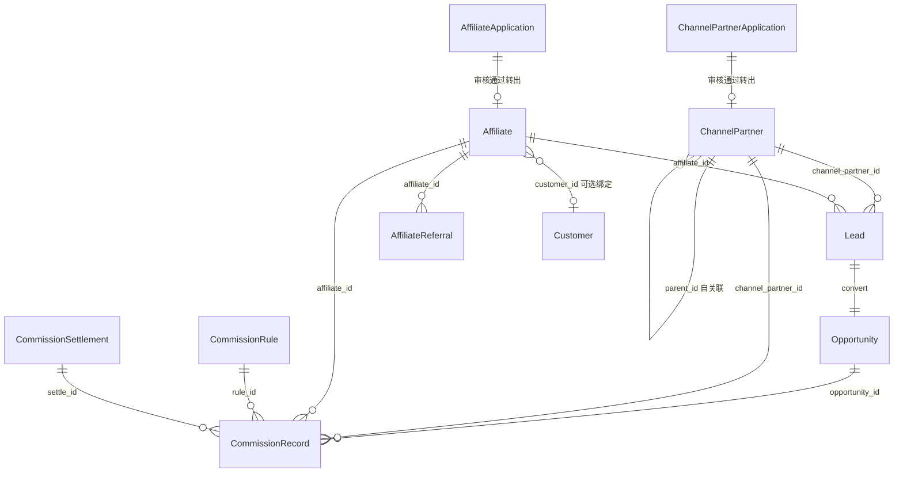

---

## 5. 分成规则设计

### 5.1 四类分成

| 分成类型 | rule_type | 触发条件 | 计算基数 | 比例来源 |
|----------|-----------|----------|----------|----------|
| 渠道商分成 | `channel` | 线索归属渠道商且成交 | 商机成交金额 `actual_amount` | CommissionRule 命中 / ChannelPartner.commission_rate |
| 上级渠道分成 | `channel_parent` | 渠道商为二级且父级存在 | 同上 | 父级 `parent_override_rate` / 规则 |
| 销售分成 | `sales` | 线索有 `assigned_to` 且成交 | 同上 | CommissionRule（sales 类型） |
| Affiliate 分成 | `affiliate` | 线索归属 affiliate 且成交 | 同上 | CommissionRule / Affiliate.commission_rate |

### 5.2 分成比例约束

- 所有比例 ∈ [0, 1]，存储为 `Decimal(5,4)`
- 四类分成比例之和无硬性上限约束（业务可叠加，由规则配置决定），但 `commission_amount` 之和不超过 `base_amount`（超额时按比例缩减，详见 §6.3）
- 二级渠道成交时：`channel`（二级） + `channel_parent`（一级）≤ 一定阈值（建议 30%），由规则配置控制

### 5.3 二级渠道分成示例

> 配置：二级渠道商 B（parent=A，commission_rate=0.10），一级渠道商 A（parent_override_rate=0.05），销售 S（sales 规则 rate=0.03），affiliate 无关。

成交金额 10000 元：
- B 渠道分成：10000 × 0.10 = 1000 元
- A 上级分成：10000 × 0.05 = 500 元
- S 销售分成：10000 × 0.03 = 300 元
- 合计发放 1800 元

---

## 6. 分成计算逻辑

### 6.1 触发时机

监听 `crm.opportunity.won` 事件（商机赢单时），由 `CommissionService.calculate_for_opportunity(opportunity_id)` 触发。

### 6.2 计算流程

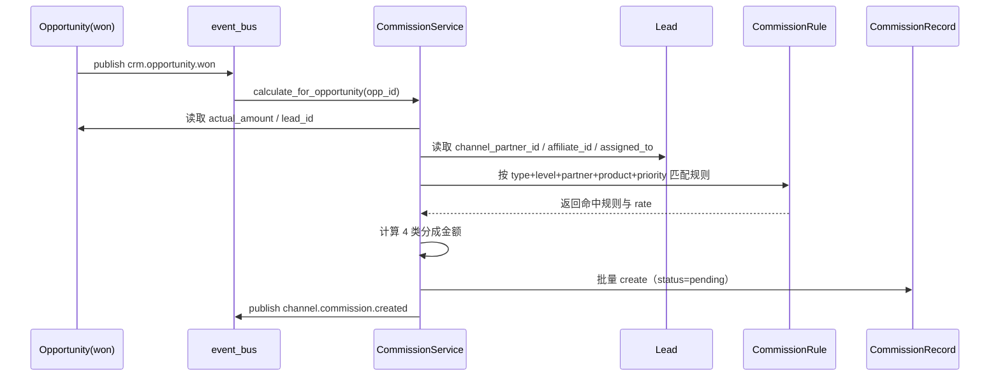

### 6.3 核心算法伪代码

```python
async def calculate_for_opportunity(opportunity_id: int, operated_by: int):
    opp = await Opportunity.get_or_none(id=opportunity_id)
    if not opp or opp.status != OpportunityStatus.WON:
        return
    if await CommissionRecord.filter(opportunity_id=opportunity_id).exists():
        return  # 幂等：已计算过则跳过

    lead = await Lead.get_or_none(id=opp.lead_id) if hasattr(opp, "lead_id") else None
    base_amount = opp.actual_amount or opp.expected_amount
    records = []

    # 1. 渠道商分成
    if lead and lead.channel_partner_id:
        cp = await ChannelPartner.get_or_none(id=lead.channel_partner_id)
        if cp and cp.status == ChannelPartnerStatus.ACTIVE:
            rule = await match_rule("channel", partner_level=cp.level,
                                    channel_partner_id=cp.id, product_id=opp.product_id)
            rate = (rule.base_rate if rule else cp.commission_rate) or Decimal(0)
            rate = clamp(rate, rule.min_rate, rule.max_rate) if rule else rate
            records.append(build_record("channel", base_amount, rate,
                                        channel_partner_id=cp.id,
                                        channel_partner_level=cp.level, rule_id=rule.id if rule else None))

            # 2. 上级渠道分成（仅二级渠道）
            if cp.level == 2 and cp.parent_id:
                parent = await ChannelPartner.get_or_none(id=cp.parent_id)
                if parent and parent.status == ChannelPartnerStatus.ACTIVE:
                    prule = await match_rule("channel_parent", partner_level=1,
                                             channel_partner_id=parent.id, product_id=opp.product_id)
                    prate = (prule.base_rate if prule else parent.parent_override_rate) or Decimal(0)
                    records.append(build_record("channel_parent", base_amount, prate,
                                                channel_partner_id=parent.id,
                                                parent_partner_id=parent.id,
                                                channel_partner_level=1, rule_id=prule.id if prule else None))

    # 3. 销售分成
    if lead and lead.assigned_to:
        srule = await match_rule("sales", product_id=opp.product_id)
        srate = srule.base_rate if srule else Decimal(0)
        records.append(build_record("sales", base_amount, srate,
                                    sales_user_id=lead.assigned_to, rule_id=srule.id if srule else None))

    # 4. Affiliate 分成
    if lead and lead.affiliate_id:
        af = await Affiliate.get_or_none(id=lead.affiliate_id)
        if af and af.status == "active":
            arule = await match_rule("affiliate", affiliate_id=af.id, product_id=opp.product_id)
            arate = (arule.base_rate if arule else af.commission_rate) or Decimal(0)
            records.append(build_record("affiliate", base_amount, arate,
                                        affiliate_id=af.id, rule_id=arule.id if arule else None))

    # 6.4 超额保护：分成总和不超过 base_amount
    total = sum(r.commission_amount for r in records)
    if total > base_amount:
        scale = base_amount / total
        for r in records:
            r.commission_amount = (r.commission_amount * scale).quantize(Decimal("0.01"))

    await CommissionRecord.bulk_create(records)
    await event_bus.publish("channel.commission.created", opportunity_id=opportunity_id,
                            record_count=len(records))
```

### 6.4 幂等与重算
- 同一 `opportunity_id` 已存在分成记录时跳过，避免重复计算
- 商机修改金额后需手动触发 `recalculate`（先取消旧记录，再重新计算）

---

## 7. 业务流程设计

### 7.1 线索归因流程

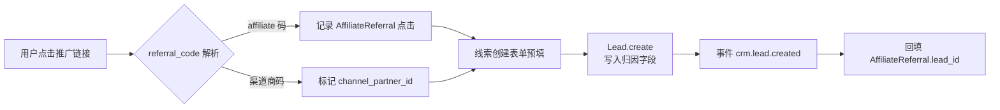

### 7.2 成交分成流程

见 §6.2 sequenceDiagram。

### 7.3 结算流程

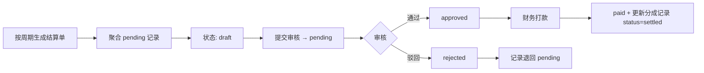

### 7.4 公开申请流程（独立申请页面）

渠道商与 affiliate 各有**独立对外公开申请页面**，无需登录系统后台即可提交入驻申请，进入审核流后由后台运营审核。

#### 7.4.1 申请页面路由（前端）

申请页面独立于 admin 后台，挂在公开路由下，无需 token：

| 路由 | 页面 | 访问方式 |
|------|------|----------|
| `/apply/partner` | 渠道商申请页 | 公开，含公司资质上传 |
| `/apply/affiliate` | affiliate 申请页 | 公开，含两种模式切换 |
| `/apply/status/{apply_no}` | 申请进度查询页 | 公开，凭单号查进度 |

> 前端文件位置：`web/src/views/apply/PartnerApply.vue`、`AffiliateApply.vue`、`ApplyStatus.vue`
> 后台审核页：`web/src/views/channel/applications/PartnerApplyReview.vue`、`AffiliateApplyReview.vue`

#### 7.4.2 渠道商申请流程

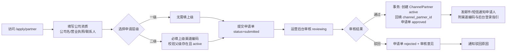

#### 7.4.3 affiliate 申请流程（双模式）

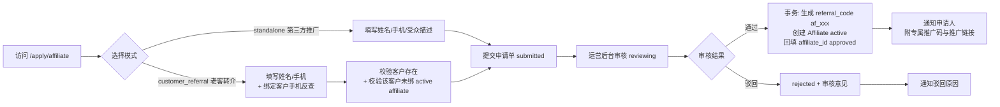

#### 7.4.4 防刷与约束
- 申请提交接口加 IP 限流（同 IP 每小时 ≤ 10 次）+ 手机号验证码校验
- 同一手机号 + 公司名（渠道商）或 同一手机号（affiliate）已有 approved 申请时拒绝
- `customer_referral` 模式严格校验：客户存在 + 客户未绑定 active affiliate + 不可绑定自己为新客户（防自返佣）
- 审核通过前申请单可由申请人凭 apply_no 撤回（status 置为 cancelled）

---

## 8. API 接口设计

接口统一挂载在 `/v1/channel/`，路由文件位于 `base/plugins/channel/api/v1/`。

### 8.1 渠道商接口

| 方法 | 路径 | 说明 |
|------|------|------|
| GET | `/v1/channel/partners` | 渠道商列表（支持 level/status/keyword 过滤） |
| GET | `/v1/channel/partners/{id}` | 渠道商详情（含下级渠道） |
| POST | `/v1/channel/partners` | 创建渠道商（自动校验层级） |
| PUT | `/v1/channel/partners/{id}` | 更新渠道商 |
| POST | `/v1/channel/partners/{id}/activate` | 启用渠道商 |
| POST | `/v1/channel/partners/{id}/suspend` | 暂停渠道商 |
| GET | `/v1/channel/partners/{id}/sub-partners` | 查询某一级渠道商下的二级列表 |
| GET | `/v1/channel/partners/{id}/tree` | 渠道树（一级 + 下属二级） |
| GET | `/v1/channel/partners/check-parent` | 公开：校验上级渠道编码是否存在且可挂（二级申请时用） |

### 8.2 Affiliate 接口

| 方法 | 路径 | 说明 |
|------|------|------|
| GET | `/v1/channel/affiliates` | affiliate 列表 |
| POST | `/v1/channel/affiliates` | 创建 affiliate（自动生成 referral_code） |
| GET | `/v1/channel/affiliates/{id}` | 详情（含点击/转化统计） |
| PUT | `/v1/channel/affiliates/{id}` | 更新 |
| POST | `/v1/channel/affiliates/{id}/activate` | 启用 |
| GET | `/v1/channel/referral/resolve` | 根据 referral_code 解析归因对象 |

### 8.3 分成规则接口

| 方法 | 路径 | 说明 |
|------|------|------|
| GET | `/v1/channel/commission-rules` | 规则列表 |
| POST | `/v1/channel/commission-rules` | 创建规则 |
| PUT | `/v1/channel/commission-rules/{id}` | 更新规则 |
| DELETE | `/v1/channel/commission-rules/{id}` | 删除规则 |

### 8.4 分成记录与结算接口

| 方法 | 路径 | 说明 |
|------|------|------|
| GET | `/v1/channel/commission-records` | 分成记录列表（支持 type/partner/affiliate/status 过滤） |
| GET | `/v1/channel/commission-records/by-opportunity/{opp_id}` | 按商机查询分成 |
| POST | `/v1/channel/commission-records/recalculate` | 重算指定商机分成 |
| POST | `/v1/channel/settlements/generate` | 按周期生成结算单 |
| GET | `/v1/channel/settlements` | 结算单列表 |
| GET | `/v1/channel/settlements/{id}` | 结算单详情（含分成明细） |
| POST | `/v1/channel/settlements/{id}/approve` | 审核通过 |
| POST | `/v1/channel/settlements/{id}/reject` | 审核驳回 |
| POST | `/v1/channel/settlements/{id}/pay` | 标记已打款 |

### 8.5 统计接口

| 方法 | 路径 | 说明 |
|------|------|------|
| GET | `/v1/channel/stats/partner-summary` | 渠道商业绩汇总（线索数/成交额/分成总额） |
| GET | `/v1/channel/stats/affiliate-summary` | affiliate 业绩汇总 |
| GET | `/v1/channel/stats/sales-summary` | 销售分成汇总 |
| GET | `/v1/channel/stats/trend` | 分成趋势（按月） |

### 8.6 公开申请接口（无需登录）

挂在公开路由前缀 `/v1/public/channel/` 下，不经过 admin 鉴权中间件，加 IP 限流 + 验证码。

| 方法 | 路径 | 说明 |
|------|------|------|
| POST | `/v1/public/channel/apply/partner` | 提交渠道商申请（创建 ChannelPartnerApplication status=submitted） |
| POST | `/v1/public/channel/apply/affiliate` | 提交 affiliate 申请（含 bind_mode 校验） |
| GET | `/v1/public/channel/apply/status/{apply_no}` | 凭单号查询申请进度（仅返回 status，不泄露审核人等内部信息） |
| POST | `/v1/public/channel/apply/{apply_no}/cancel` | 申请人撤回未审核的申请 |
| POST | `/v1/public/channel/sms/code` | 发送手机验证码（限流） |
| GET | `/v1/public/channel/apply/customer/lookup` | customer_referral 模式下凭手机号反查客户是否存在（仅返回 exists 布尔，不泄露客户信息） |

### 8.7 后台审核接口（需登录 + channel:apply:review 权限）

| 方法 | 路径 | 说明 |
|------|------|------|
| GET | `/v1/channel/applications/partner` | 渠道商申请列表（支持 status 过滤） |
| GET | `/v1/channel/applications/partner/{id}` | 渠道商申请详情 |
| POST | `/v1/channel/applications/partner/{id}/approve` | 审核通过（事务内创建 ChannelPartner） |
| POST | `/v1/channel/applications/partner/{id}/reject` | 审核驳回（带 review_remark） |
| GET | `/v1/channel/applications/affiliate` | affiliate 申请列表 |
| GET | `/v1/channel/applications/affiliate/{id}` | affiliate 申请详情 |
| POST | `/v1/channel/applications/affiliate/{id}/approve` | 审核通过（事务内创建 Affiliate + 生成 referral_code） |
| POST | `/v1/channel/applications/affiliate/{id}/reject` | 审核驳回 |

---

## 9. 状态流转设计

### 9.1 渠道商状态机

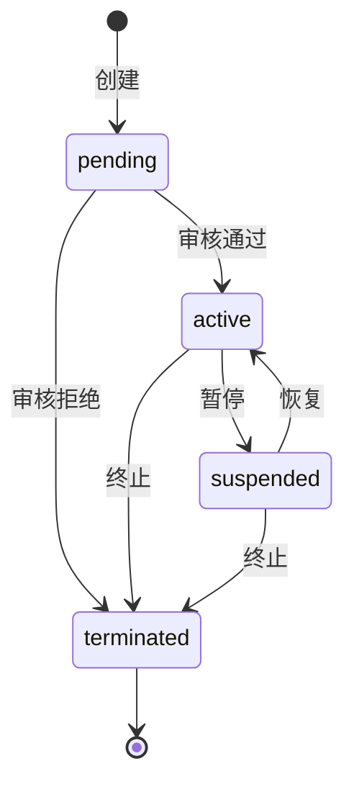

### 9.2 分成记录状态机

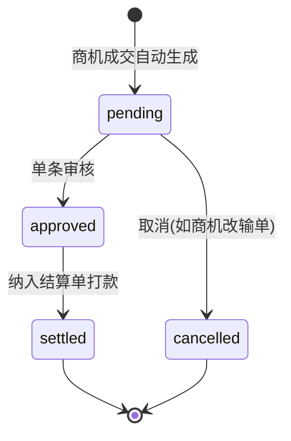

### 9.3 结算单状态机

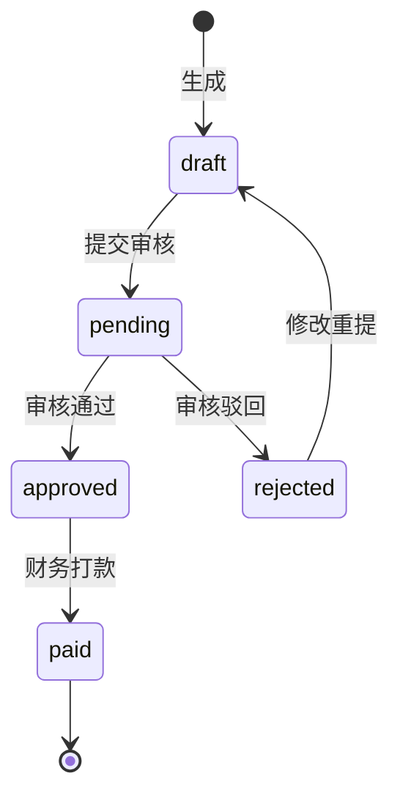

### 9.4 申请单状态机（渠道商 / affiliate 通用）

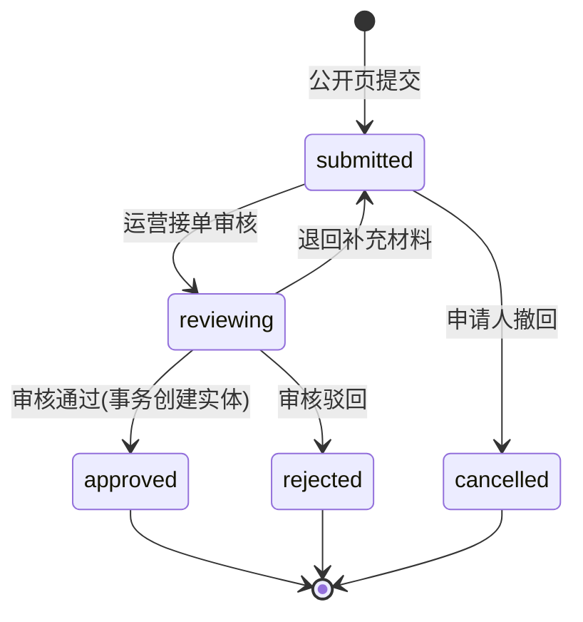

> 注：`submitted → reviewing` 由运营在后台点击"开始审核"触发；也可配置为提交即进入 reviewing。审核通过时同步创建 ChannelPartner/Affiliate 实体并回填 ID，整段在一个数据库事务内完成。

---

## 10. 关键约束与边界条件

### 10.1 层级约束
- **最多 2 级**：创建渠道商时若 `parent_id` 指向的渠道商 `level=2`，则拒绝创建（防 3 层）
- 二级渠道商不能再有下级（`level=2` 的渠道商不允许作为他人的 `parent_id`）
- 修改 `parent_id` 时需重新校验层级，且自动重算 `parent_path`

### 10.2 线索归因约束
- 一条线索最多关联 1 个渠道商 + 1 个 affiliate
- 已成交的线索禁止修改归因字段（防止分成错乱）
- 修改归因字段需权限校验（仅管理员）

### 10.3 分成幂等
- `opportunity_id` 维度幂等：同商机重复触发只生成一次分成
- 商机状态从 `won` 变为 `lost` 时，自动将关联分成记录置为 `cancelled`

### 10.4 金额边界
- `base_amount` 取 `actual_amount`，无值时回退 `expected_amount`，两者皆无则不生成
- 分成总和超过 `base_amount` 时按比例缩减（见 §6.3）
- 比例为 0 或规则未命中且对象无默认比例时，不生成对应类型记录

### 10.5 插件依赖
- 本插件依赖 `crm` 插件（监听其事件、扩展其 Lead 模型）
- CRM 插件未启用时，本插件定时任务（结算单生成、统计聚合）跳过执行
- Lead 模型扩展通过 SQL migration 实现（`migrations/channel_add_lead_attribution_<ts>.sql`），仅 crm 插件启用时执行

### 10.6 权限
- 渠道商/affiliate 增删改：需 `channel:manage` 权限
- 分成规则配置：需 `channel:rule:manage` 权限
- 结算审核：需 `channel:settle:approve` 权限
- 打款：需 `channel:settle:pay` 权限
- 申请审核：需 `channel:apply:review` 权限

### 10.7 公开申请安全约束
- 公开申请接口（§8.6）不经过 admin 鉴权，需独立限流：同 IP 每小时 ≤ 10 次提交
- 手机号必须验证码校验（短信验证码 5 分钟有效）
- 上传文件（营业执照等）需校验类型与大小，存独立 OSS/storage 路径，不与业务数据混放
- 申请进度查询接口仅返回 status + 提交时间，禁止返回 reviewer_id / review_remark 等内部字段
- customer_referral 模式 customer 反查接口仅返回 `{exists: bool}`，避免手机号枚举泄露客户信息

### 10.8 事件清单

| 事件名 | 触发时机 | payload |
|--------|----------|---------|
| `channel.partner.created` | 渠道商创建（含审核通过自动创建） | partner_id, level, parent_id, source=manual/application |
| `channel.partner.status_changed` | 状态变更 | partner_id, old_status, new_status |
| `channel.affiliate.created` | affiliate 创建 | affiliate_id, bind_mode, referral_code |
| `channel.application.submitted` | 申请单提交 | apply_no, apply_type |
| `channel.application.approved` | 申请审核通过 | apply_no, apply_type, entity_id |
| `channel.application.rejected` | 申请审核驳回 | apply_no, apply_type, reason |
| `channel.commission.created` | 分成记录生成 | opportunity_id, record_count |
| `channel.settlement.paid` | 结算打款 | settle_id, total_amount |

---

## 11. 落地清单（参考）

1. 新建插件目录 `base/plugins/channel/`，含 `manifest.json`、`models/`、`schemas/`、`services/`、`api/v1/`
2. Lead 模型扩展：在 `crm_lead` 表追加 `channel_partner_id` / `affiliate_id` / `referral_code` 三字段（migration）
3. 注册 9 个模型（ChannelPartner/Affiliate/AffiliateReferral/CommissionRule/CommissionRecord/CommissionSettlement/ChannelPartnerApplication/AffiliateApplication + Lead 扩展）到 `tortoise.Tortoise.init` 的 models 列表（启动时全量注册，不与插件启停耦合）
4. 事件订阅：在 `tortoise.init()` 完成后注册 `crm.opportunity.won` 订阅者
5. 前端后台页面：`web/src/views/channel/` 新增渠道商、affiliate、分成规则、分成记录、结算、**申请审核** 六个管理页面
6. 前端公开申请页面：`web/src/views/apply/` 新增 `PartnerApply.vue`、`AffiliateApply.vue`、`ApplyStatus.vue`，挂在公开路由（无需 token），与 admin 路由分离打包
7. 公开申请接口独立路由前缀 `/v1/public/channel/`，配置 IP 限流 + 短信验证码中间件
8. 菜单与权限项通过插件 `manifest.json` 自动注册（含 `channel:apply:review` 权限）
9. 短信/邮件通知模板：申请提交确认、审核通过（附渠道编码/推广码）、审核驳回（附原因）三套模板
